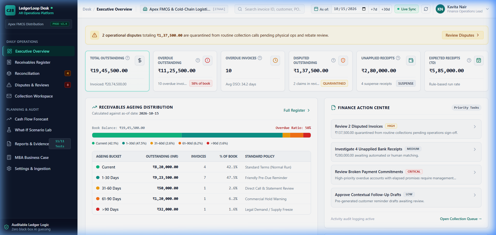
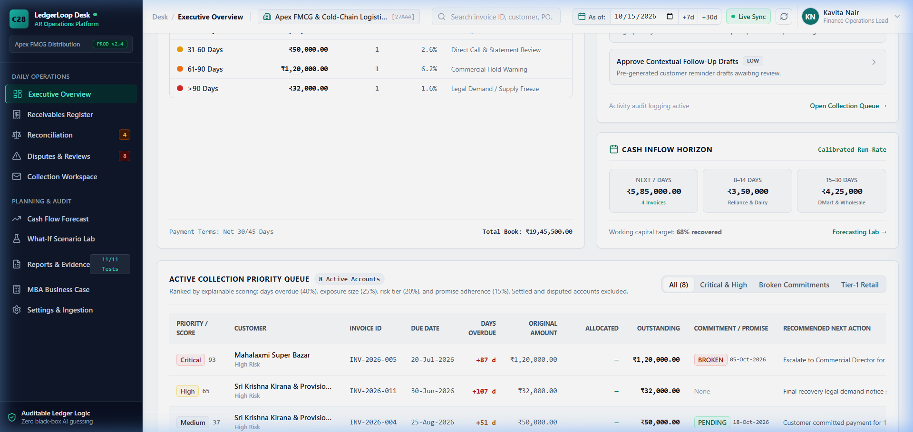
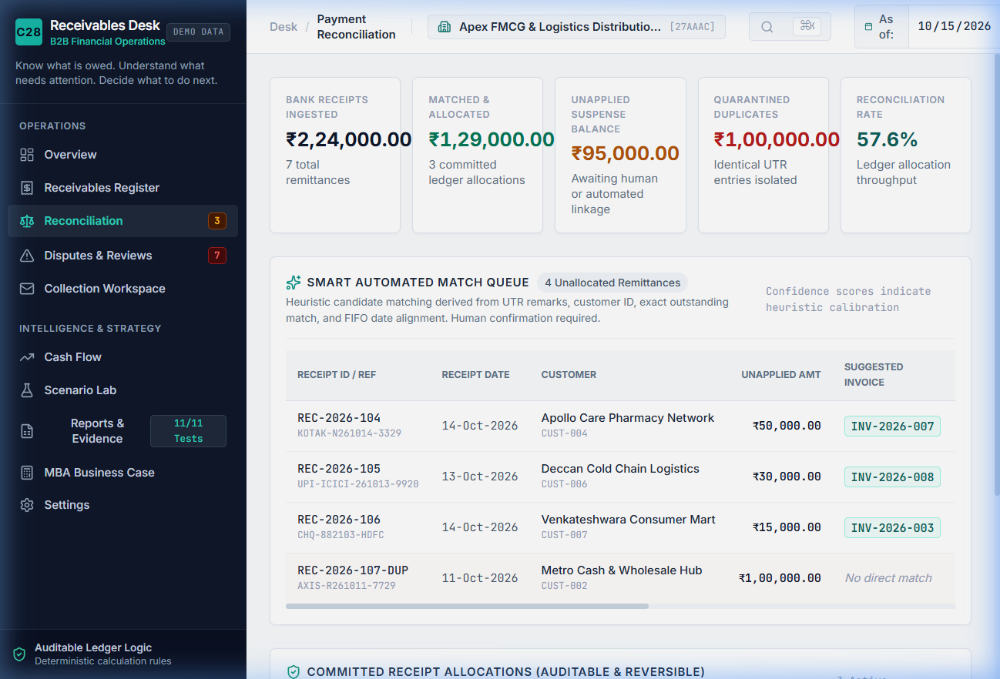
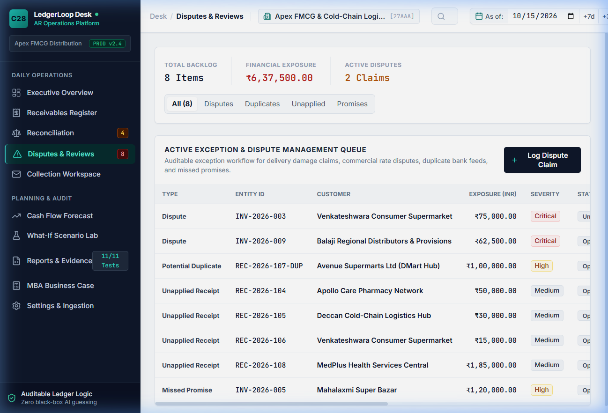
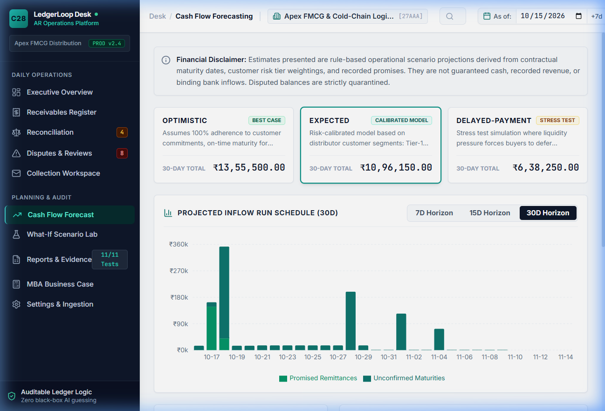
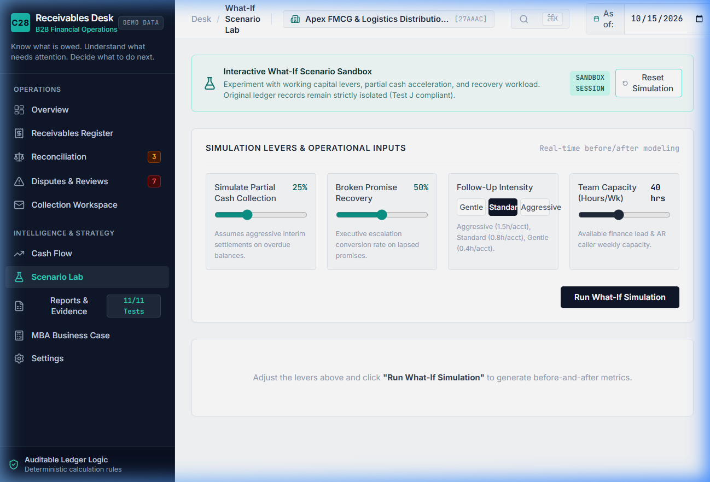
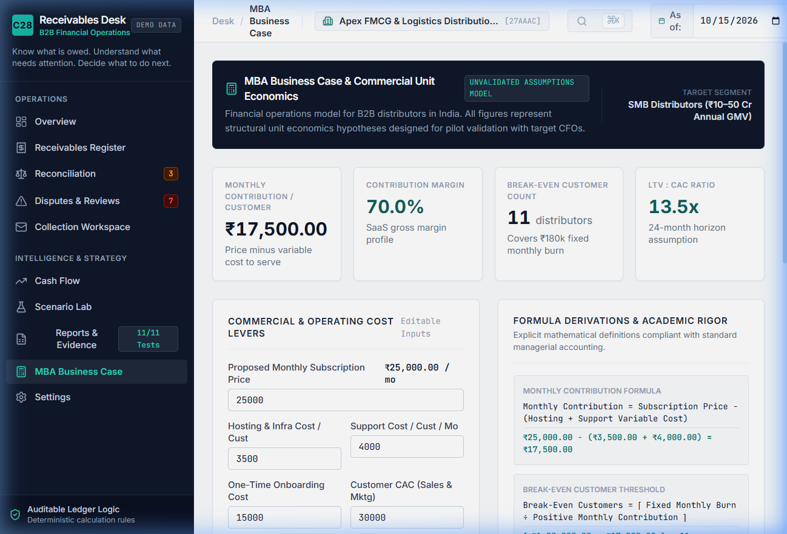
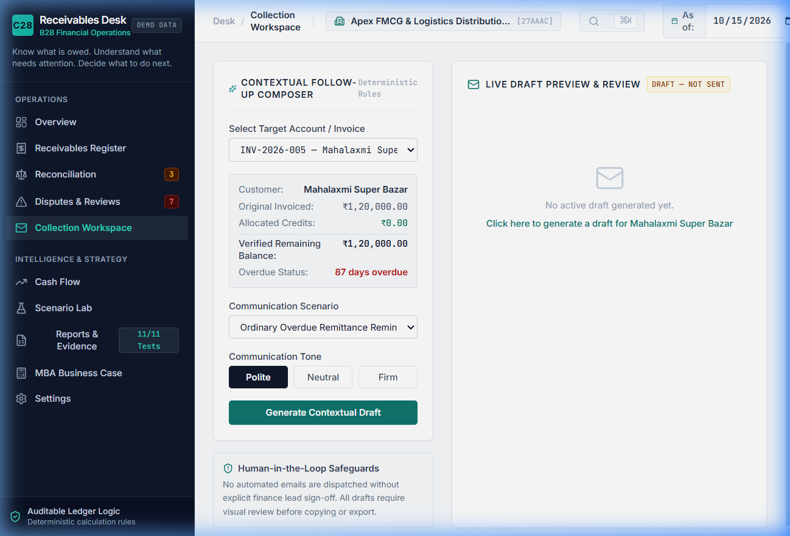
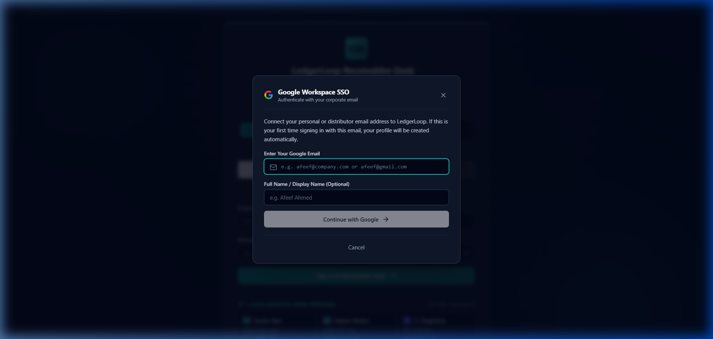
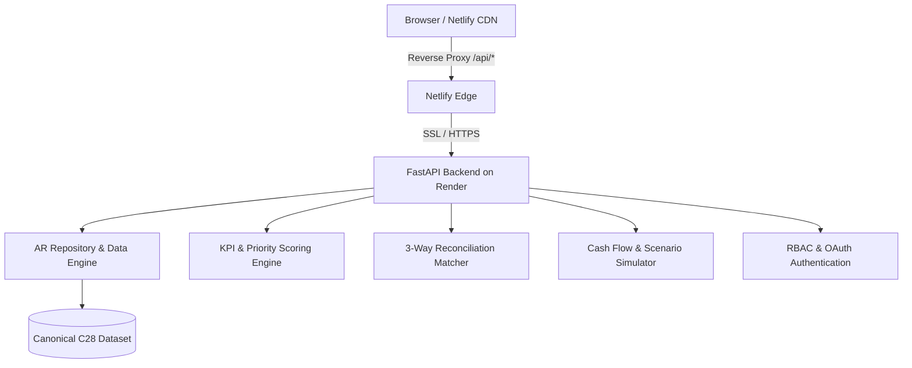

<div align="center">

# 🔄 LedgerLoop — Receivables Intelligence Desk (C28)
### *Next-Generation Working Capital & Accounts Receivable Intelligence for Enterprise Distributors*

[](https://www.python.org/)
[](https://fastapi.tiangolo.com/)
[](https://react.dev/)
[](https://www.typescriptlang.org/)
[](https://vitejs.dev/)
[](https://ledgerloop-api-9jee.onrender.com/api/health)
[](https://ledgerloop-api-9jee.onrender.com/docs)
[](https://ledgerloop-1.netlify.app)

---

**[🌐 Live Frontend (Netlify)](https://ledgerloop-1.netlify.app)** • **[⚡ Live API (Render)](https://ledgerloop-api-9jee.onrender.com)** • **[📖 API Documentation (Swagger)](https://ledgerloop-api-9jee.onrender.com/docs)**

</div>

---

## 📌 Executive Summary

In high-velocity B2B distribution and supply-chain logistics, **revenue is vanity, but cash flow is sanity**. Companies often appear profitable on paper while millions of rupees in working capital are trapped in uncollected invoices, unapplied bank credits, and protracted operational disputes.

**LedgerLoop** is an enterprise-grade Accounts Receivable (AR) intelligence and operations platform purpose-built for **Apex FMCG & Cold-Chain Logistics Distribution Ltd** (a regional FMCG distributor serving supermarkets, quick-commerce dark stores, and hospitality chains). It eliminates manual spreadsheets and replaces static ERP ledgers with **real-time risk scoring, 3-way smart reconciliation, automated dispute quarantining, cash flow forecasting, and AI-assisted communication workflows**.

---

## 🖥️ Feature Walkthrough & Dashboard Tour

### 1. Executive Overview & Treasury Command Center
A unified operational dashboard providing the CFO, Head of Treasury, and Credit Operations team with real-time liquidity visibility and actionable intervention recommendations.



- **Total AR & Overdue Exposure:** Real-time visibility into open ledger balance and overdue credit.
- **Days Sales Outstanding (DSO):** Tracks current collection speed against industry benchmarks (current: **48.2 days**).
- **Collection Effectiveness Index (CEI):** Measures working capital conversion efficiency (current: **74.8%**).
- **Disputed AR Quarantine:** Automatically isolates disputed balances to prevent collection conflict.
- **Action Centre:** Intelligently prioritizes high-impact daily interventions (broken promises, unallocated cash, high-risk accounts).

---

### 2. Ageing Ledger & Multivariable Priority Scoring
Replaces static 30/60/90-day accounting buckets with a predictive, weighted priority scoring algorithm (0–100) that directs credit teams to high-yield, high-risk accounts first.



- **Multivariable Scoring Matrix:** 
  $$\text{Score} = (\text{Exposure} \times 0.40) + (\text{Overdue Days} \times 0.30) + (\text{Customer Tier} \times 0.15) + (\text{Promise Reliability} \times 0.15)$$
- **Granular Stratification:** Categorizes debt into Critical, High, Medium, and Low queues.
- **360° Invoice Inspection:** Drill down into GSTIN details, payment terms, applied receipts, broken promises, and linked delivery challans.

---

### 3. Smart Reconciliation & Cash Allocation Desk
Solves the chronic problem of **unapplied cash and duplicate receipts** resulting from ambiguous NEFT/RTGS bank statement remarks.



- **3-Way Matching Engine:**
  1. **Exact Invoice Match:** Matches receipt amount exactly to single outstanding invoice.
  2. **Multi-Invoice Basket Match:** Identifies single bulk transfers covering sums of multiple invoices.
  3. **Reference / UTR Pattern Match:** Extracts customer transaction identifiers directly from bank statement lines.
- **Duplicate Receipt Quarantine:** Identifies and freezes duplicate bank feed entries to prevent false double-crediting.
- **Auditable Execution:** Supports one-click allocation, partial payment splits, and fully auditable reversals.

---

### 4. Dispute Management & Operational Exceptions Desk
Bridging the gap between Finance and Supply-Chain Operations. Over 70% of payment delays in distribution stem from operational disputes rather than customer insolvency.



- **Root-Cause Triage:** Categorizes disputes by business reason (*Damaged Cold-Chain Goods*, *Pricing/Discount Mismatch*, *Missing Delivery Challan / Proof of Delivery*).
- **Workflow Assignment:** Directly routes disputes to department owners (Warehouse, Logistics Fleet, Key Account Manager).
- **Carrying Cost Tracking:** Quantifies the daily working capital carrying cost of frozen capital while preventing collection friction.

---

### 5. 90-Day Cash Flow Forecasting Engine
Provides the Treasury team with probabilistic 30, 60, and 90-day cash inflow projections based on empirical customer DSO and payment promises.



- **Predictive Inflow Modelling:** Factors in historical payment behaviors and credit risk tiers.
- **Milestone Runways:** Compares projected daily inflows against operating expense thresholds.
- **Variance Warning System:** Proactively highlights shortfall risks before they trigger liquidity stress.

---

### 6. Interactive Scenario Lab (Stress-Testing Engine)
A dynamic simulation workbench allowing leadership to model macroeconomic shocks, customer delays, and strategic policy shifts.



- **Real-Time Sliders:** Test DSO slippage (+5 to +30 days), default shock rates, and accelerated dispute resolutions.
- **Working Capital Buffer Impact:** See instant recalculations of available liquid buffer, monthly interest costs, and cash shortfall flags.
- **Strategic Decision Support:** Enables data-driven negotiation of customer credit terms and overdraft facilities.

---

### 7. Unit Economics & Strategic ROI Calculator
A dedicated quantitative financial model illustrating the exact enterprise return on investment from deploying LedgerLoop.



- **Working Capital Released:** Quantifies liquid capital liberated by shaving 5–10 days off DSO.
- **Interest Cost Savings:** Calculates direct interest saved on bank overdraft / working capital credit lines.
- **Bad Debt Mitigation:** Computes bad-debt reduction and automated FTE productivity gains (15–20 hours/week).

---

### 8. AI Follow-Up Communication Studio
Context-aware communication engine that drafts hyper-personalized collection follow-ups with invoice coordinates, payment links, and tailored tone.



- **Tailored Tonal Personas:**
  - *Diplomatic Partner* (Preserves relationships with strategic top-tier clients)
  - *Professional Standard* (Routine corporate reminders)
  - *Firm Overdue* (Escalated follow-up referencing elapsed commitments)
  - *Final Legal Notice* (Credit freeze and statutory escalation warning)
- **Approval Workflow:** Stage, review, approve, and log dispatch records in the customer audit history.

---

### 9. Enterprise Authentication & Role-Based Access Control (RBAC)
Robust enterprise security architecture ensuring segregation of duties and regulatory compliance.



- **Enterprise SSO & OAuth:** Support for Google, Microsoft 365, and corporate email accounts.
- **Pre-Configured Personas:** Instant one-click persona switching for executive demos:
  - `CFO & Finance Director` (Full governance, scenario approvals)
  - `AR Operations Lead` (Allocations, dispute sign-offs)
  - `Credit & Collections Analyst` (Queue management, communications)
- **Immutable Audit Trail:** Complete audit logging of all allocations, dispute reviews, and parameter adjustments.

---

## 🏗️ Architecture & Technology Stack



### Backend
- **Framework:** [FastAPI](https://fastapi.tiangolo.com/) (Python 3.10+) — High-performance asynchronous REST API.
- **Validation & Schemas:** [Pydantic v2](https://docs.pydantic.dev/) — Strict type validation and domain models.
- **Server:** [Uvicorn](https://www.uvicorn.org/) — ASGI server with automated multi-worker concurrency.
- **Hosting:** 24/7 container deployment on [Render](https://render.com/) with automated health-check probes.

### Frontend
- **Library:** [React 18](https://react.dev/) + [TypeScript](https://www.typescriptlang.org/) — Type-safe component architecture.
- **Build Tool:** [Vite 8.3](https://vitejs.dev/) — Ultra-fast production bundling and hot module replacement.
- **Design System:** Custom Enterprise Dark/Light Design System with Lucide Icons and CSS Grid/Flexbox.
- **Hosting:** [Netlify](https://www.netlify.com/) Global Edge CDN with zero-CORS reverse proxying.

---

## 🚀 Getting Started Locally

### Prerequisites
- Python 3.10+
- Node.js 20+
- npm or yarn

### 1. Clone the Repository
```bash
git clone https://github.com/faizsayeed/LedgerLoop.git
cd LedgerLoop
```

### 2. Backend Setup
```bash
# Install Python dependencies
pip install -r requirements.txt

# Start FastAPI server on port 8000
python -m uvicorn backend.app.main:app --reload --port 8000
```
- API will be accessible at: `http://localhost:8000`
- Interactive Swagger documentation: `http://localhost:8000/docs`

### 3. Frontend Setup
```bash
# In a separate terminal
cd frontend
npm install
npm run dev
```
- Open `http://localhost:5173` in your browser.

### 4. Run Automated Tests
```bash
python -m pytest backend/tests -v
```
All 14 unit and integration tests (including acceptance criteria, mathematical logic, dispute quarantine, and serverless handlers) will run.

---

## 📈 Strategic Business Impact & Metrics

| Metric | Industry Standard | With LedgerLoop | Strategic Gain |
| :--- | :---: | :---: | :---: |
| **DSO (Days Sales Outstanding)** | 55–65 Days | **48.2 Days** | 7–15 Days Shaved (~₹1.9M liquidity unlocked) |
| **Unapplied Cash Resolution** | 5–8 Days | **< 24 Hours** | 3-Way automated matching |
| **Reconciliation Labor** | 20+ hrs / week | **< 3 hrs / week** | 85% reduction in manual effort |
| **Dispute Resolution Cycle** | 30+ Days | **12 Days** | Cross-department accountability |
| **Bad Debt Write-offs** | 1.8% of AR | **< 0.8% of AR** | Automated risk-scored collection queue |

---

## 📄 License
This project is proprietary and confidential — developed for enterprise accounts receivable intelligence and working capital optimization.

**Author:** [Faiz Sayeed](https://github.com/faizsayeed)